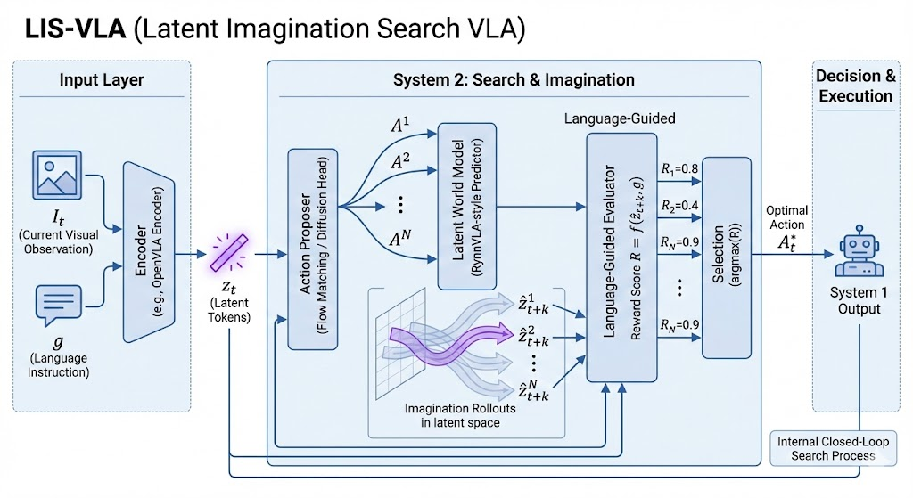

# LIS-VLA: Latent Imagination Search VLA

> Built on [RynnVLA-002](https://github.com/alibaba-damo-academy/RynnVLA-002), LIS-VLA turns the one-way "perception → action" pipeline into a **closed-loop search in latent space**: from a single backbone forward pass it proposes N candidate action chunks, imagines the future each one leads to in latent space, scores those futures against the language instruction, and executes the best one.



## Core idea

| Component | Place in figure | Implementation (`rynnvla-002/model/lis/modules.py`) |
|---|---|---|
| Encoder → $z_t$ | Input Layer | Chameleon backbone (RynnVLA-002). $z_t$ = `ObservationEncoder`: Perceiver-style attention pooling over the **input embeddings of the VQ tokens** of each current view, giving Q latent tokens (16×512 by default). It depends only on the observation, so the same encoder also produces the target $z_{t+k}$ from the future frame. |
| Action Proposer | System 2 | `FlowMatchingProposer`: a rectified-flow head conditioned on the action-query features of the RynnVLA action head plus backbone context tokens $c_t$; samples N action chunks $A^1..A^N$ in parallel with 10 Euler steps. Candidate #0 is always the deterministic System 1 output (the original L1 action head), so the selected chunk never scores worse than not searching. |
| Latent World Model | System 2 | `LatentWorldModel`: $\hat z_{t+k} = z_t + D([z_t; c_t; A])$, a Transformer dynamics head whose output layer is zero-initialised (an untrained model predicts "nothing changes"). No pixels are generated; k = H (chunk length). |
| Language-Guided Evaluator | System 2 | `LanguageGuidedEvaluator`: $R = \cos(\phi(\hat z_{t+k}), \psi(g))$, where $g$ pools the backbone hidden states of the instruction tokens. |
| Selection | Decision | $A^* = \arg\max_i \; R^i - \text{Cost}(A^i)$, with optional CEM refinement rounds; the whole chunk is executed (same action chunking as RynnVLA-002). |

### Search objective

$$
A_t^* = \arg\max_{A \in \{A^i\}_{i=1}^N} \; \mathrm{Sim}\big(\phi(\hat z_{t+k}),\, \psi(g)\big) - \mathrm{Cost}(A), \qquad \hat z_{t+k} = \mathcal{WM}(z_t, c_t, A)
$$

$$
\mathrm{Cost}(A) = \lambda_s \frac{1}{H-1}\sum_{i}\lVert a_{i+1}^{\text{arm}} - a_i^{\text{arm}}\rVert^2 + \lambda_p \frac{1}{H}\lVert A - A^{\text{S1}}\rVert^2
$$

Notes: the world model is currently deterministic, so the expectation $\mathbb{E}_{\hat z\sim\mathcal{WM}}$ reduces to a single prediction. The smoothness term is not applied to the gripper dimension (gripper commands are meant to switch). $A^{\text{S1}}$ is the System 1 output; $\lambda_p$ defaults to 0.

### Training objectives (all in latent space)

An LIS training sample appends the future frame reached after executing the chunk to the VLA sequence, so a single sequence supervises every component:

```
human: What action should the robot take to {task}? <|state|> <|image|>×(his·V)
gpt  : <|action|>×H  <|image|>×V        ← third-person + wrist views at time t+H
```

| Loss | Purpose | Default weight |
|---|---|---|
| `lis_fm` | Flow matching: $\lVert v_\theta(x_\tau,\tau)-(a-x_0)\rVert^2$ with logit-normal τ | 1.0 |
| `lis_wm` | $1-\cos(\hat z_{t+H}, \mathrm{sg}[z_{t+H}])$ per latent token (JEPA-style stop-grad target) | 1.0 |
| `lis_wm_nce` | In-batch InfoNCE: a prediction must identify its own true future (prevents collapse) | 0.1 |
| `lis_var` | VICReg variance term (prevents collapse) | 0.1 |
| `lis_lang_nce` | Multi-positive InfoNCE between real/imagined future latents and instruction embeddings (samples with the same instruction are positives) | 0.1 |
| `lis_prog` | Progress ranking: $R(z_{t+H}, g) > R(z_t, g)$ | 0.05 |
| `lis_rank` | Ranking in imagination: the imagined future of the expert chunk beats those of counterfactual chunks (noised / time-reversed / mismatched within the batch) | 0.1 |

All losses reach the original trainer through the model's `additional_loss_dict`, so **the trainer itself is unchanged** and each term shows up in the logs. The original next-token CE (including generation of the t+H frame) and the continuous-action L1 loss are kept as they are.

## What changed vs. RynnVLA-002

New files:

| File | Contents |
|---|---|
| `rynnvla-002/model/lis/tokens.py` | Parses RynnVLA token sequences (positions of instruction / state / current frames / action blocks / future frames) |
| `rynnvla-002/model/lis/modules.py` | Observation/context/language encoders, proposer, latent world model, evaluator, losses, search |
| `rynnvla-002/model/modeling_lis_vla.py` | `ChameleonXLLMXForConditionalGeneration_LIS`, `LISVLAConfig`, `load_lis_model` |
| `rynnvla-002/pretrain_solver_lis_vla.py` | Training entry point (subclasses the original solver, adds all `--lis_*` options) |
| `rynnvla-002/eval_solver_libero_lis.py`, `libero_util/lis_utils.py` | LIBERO evaluation (search + per-step search log `lis_search_log.jsonl`) |
| `rynnvla-002/data/lis_conv_generation.py`, `data/pretoken_lis_model.py` | LIS training-data generation and pre-tokenisation |
| `rynnvla-002/exps_lis/*.sh`, `configs/lis/*.yaml` | Data preparation / training / evaluation scripts |
| `rynnvla-002/tests/test_lis_vla.py` | CPU smoke tests (tiny Chameleon) |

Two corrections to existing behaviour (both implemented in the subclass; original files untouched):

1. **Attention mask**: the original `generate_att_mask_3` uses the *last image* as the reference for deciding whether action blocks mask each other. LIS samples have future frames after the action blocks, which would make the chunk's action blocks visible to each other during training, unlike at inference. The LIS version uses the *last image before the first action block* as the reference. For existing VLA samples, world-model samples and inference prompts the mask is **identical** (verified by tests); it only differs on LIS samples.
2. **Action-head padding**: the original `ActionHead` lets action queries attend to zero-padded positions when context lengths differ within a batch; the LIS version masks them. Parameter names and shapes are unchanged, so **original checkpoints load directly**, and batch-1 inference is numerically identical to the original (verified by tests).

## Usage

The environment is the same as RynnVLA-002 (`requirements.txt`, torch 2.2.0 / transformers 4.43.0). First complete Step 1 of the LIBERO data preparation in [README_RynnVLA-002.md](README_RynnVLA-002.md) (regenerating images/actions/states), and download the tokenizer and RynnVLA-002 checkpoints into `rynnvla-002/ckpts/`.

### 1. Prepare LIS data

```bash
cd rynnvla-002/exps_lis
bash prepare_data.sh goal 5        # goal/object: H=5; spatial/10: H=10
```

This generates and pre-tokenises the LIS samples; if tokens for the original world-model and VLA data already exist, they are mixed into `processed_data/concate_tokens/libero_goal_..._lis_awm.json`.

### 2. Train

```bash
# Freeze RynnVLA-002 and train System 2 only (cheapest; recommended first)
bash train_lis.sh goal 5 lis_only ../ckpts/RynnVLA-002/VLA_model_256/libero_goal
# Also fine-tune the continuous action head
bash train_lis.sh goal 5 lis_and_head ../ckpts/RynnVLA-002/VLA_model_256/libero_goal
# Full fine-tuning (same setting as RynnVLA-002 training)
bash train_lis.sh goal 5 all ../ckpts/RynnVLA-002/VLA_model_256/libero_goal
```

When starting from a checkpoint without LIS weights, `load_lis_model` initialises the `lis.*` parameters automatically. `--lis_detach_backbone true` (default) stops LIS losses from back-propagating into the backbone.

### 3. Evaluate

```bash
bash eval_lis.sh goal 5 ../outputs/libero_goal/<exp>/epoch9            # search with N=16
bash eval_lis.sh goal 5 ../outputs/libero_goal/<exp>/epoch9 32 2        # N=32 + 2 CEM rounds
bash eval_lis.sh goal 5 ../outputs/libero_goal/<exp>/epoch9 16 0 0      # search off = System 1 ablation
```

### Python API

```python
from model import load_lis_model
model = load_lis_model(ckpt, torch_dtype=torch.bfloat16).cuda().eval()
chunk = model.generate_lis_action(input_ids, generation_config, num_candidates=16, cem_iters=0)  # (H, 7), normalised space
model.last_search_info   # best_score / best_semantic / best_cost / score_std / prior_score ...
```

## Size and cost

- System 2 parameters: **about 50.1M** at 7B dimensions (obs 9.0M / ctx 5.3M / lang 5.3M / proposer 13.7M / world model 12.9M / evaluator 3.9M), roughly 0.7% of the backbone.
- Search needs **no extra backbone forward pass** and decodes no pixels: all candidates are evaluated in one batched pass in the 512-d latent space.
- Reference: on 2 CPU threads in fp32, one plan takes about 0.43 s for N=16, 0.74 s for N=32 and 0.63 s for N=16 with 2 CEM rounds; GPU latency has not been measured yet.

## Tests

```bash
cd rynnvla-002
python -m pytest -q tests/test_lis_vla.py
```

Coverage: sequence parsing; attention-mask equivalence with the original and the fix on LIS samples; training forward/backward (every LIS module receives gradients); `lis_fm` / `lis_wm` / `lis_lang_nce` decrease within 60 steps; end-to-end `generate_lis_action` (including CEM and search off); state-dict compatibility and numerical equivalence with the original `ActionHead`; loading from a checkpoint without LIS weights.

## Status and suggested ablations

The code runs end to end on a tiny configuration. **It has not yet been trained or evaluated with the 7B model on LIBERO, and there are no success-rate results yet.** Suggested experiments:

1. System 1 (`SEARCH=0`) vs. LIS on the same checkpoint, N ∈ {4, 8, 16, 32};
2. Evaluator with `lis_rank` / `lis_prog` / `lis_lang_nce` removed one at a time;
3. Latent-space search vs. pixel-space search (scoring images generated by RynnVLA-002's own world model): success rate and latency;
4. `lis_only` vs. `all` training scope.

Caveat: the evaluator learns only from expert demonstrations (expert chunks vs. counterfactual chunks), so it learns a preference for "progressing the task the way the expert does"; its reliability outside the demonstration distribution needs to be verified experimentally. A very small `last_search_info["score_std"]` means the candidates are barely distinguishable.

## Acknowledgements and license

Based on [RynnVLA-002](https://github.com/alibaba-damo-academy/RynnVLA-002) (Apache-2.0); the original README is kept as [README_RynnVLA-002.md](README_RynnVLA-002.md). This repository is also released under Apache-2.0; see `LICENSE` and `NOTICE`.
